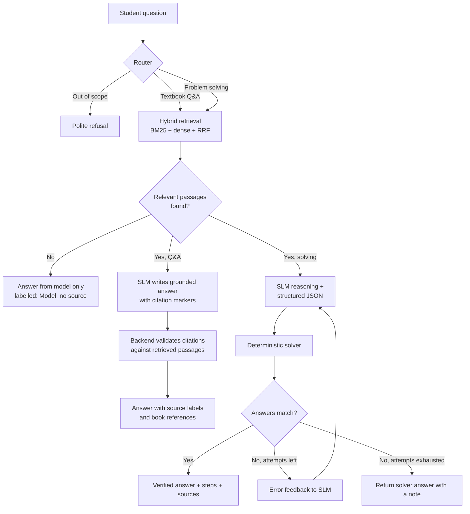

# StemMatrix: On-Device Neuro-Symbolic SLM

> An offline, zero-cloud-cost learning platform for STEM students. Ask a concept question and get a textbook-grounded answer with the book cited. Ask a numerical problem and get an exact, solver-verified answer. Every part of every answer is labelled with where it came from: **Textbook**, **Solver** or **Model**.


B.Tech Major Project, Department of Computer Science & Engineering, Islamic University of Science and Technology (IUST), Awantipora, Jammu & Kashmir, India. 2026.

---

## Table of Contents

- [Why StemMatrix](#why-stemmatrix)
- [Key Features](#key-features)
- [Two Modes, One Pipeline](#two-modes-one-pipeline)
- [Source Labels and Citations](#source-labels-and-citations)
- [Question and Answer Types](#question-and-answer-types)
- [How the Self-Healing Loop Works](#how-the-self-healing-loop-works)
- [Textbook Corpus](#textbook-corpus)
- [Tech Stack](#tech-stack)
- [Repository Structure](#repository-structure)
- [Getting Started](#getting-started)
- [API Overview](#api-overview)
- [Evaluation Plan](#evaluation-plan)
- [Roadmap](#roadmap)
- [Team](#team)
- [References](#references)
- [License](#license)

---

## Why StemMatrix

STEM learning needs two different things: **trustworthy explanations** of concepts and formulas, and **exact answers** to numerical problems. Cloud-hosted LLM study tools struggle with both:

- **Cost and connectivity.** They need per-token API payments and a constant internet connection.
- **Privacy.** Student data leaves the device.
- **Unreliable facts.** Models can state formulas and definitions confidently with no source, and students cannot tell what to trust.
- **Unreliable arithmetic.** Autoregressive models predict likely tokens rather than computing, so they make silent errors in numerical work. Asking a model to check itself without external feedback rarely helps.

StemMatrix addresses these by running everything on the device and being explicit about provenance:

1. A **fine-tuned small language model (SLM)** explains and reasons step by step.
2. **Hybrid retrieval** over standard offline textbooks grounds explanations and formula lookups, with the book, chapter and page cited.
3. A **neuro-symbolic layer** of deterministic solvers computes exact numerical answers and verifies the model's output.
4. A **self-healing loop** feeds solver errors back to the model so it can repair its own reasoning.
5. A **source label** on every part of the answer shows whether it came from a textbook, a solver or the model alone.

## Key Features

- **Fully offline.** The model, retrieval index and solvers all run locally.
- **Textbook Q&A with citations.** Ask "What is Lenz's law?" or "How do I integrate sin x?" and get the answer from a standard textbook, with the book, chapter, section and page.
- **Clear source labels.** Each part of an answer is marked as Textbook (RAG), Solver (verified) or Model (LLM, no source). If nothing relevant is found in the books, the app says so rather than guessing silently.
- **Exact answers.** Numerical results come from verified solvers (SymPy, NumPy, SciPy, Pint), not from token prediction.
- **Self-healing reasoning.** When the model's answer disagrees with the solver, the error is sent back and the model retries.
- **Hybrid retrieval.** Dense embeddings and BM25 keyword search, merged with Reciprocal Rank Fusion, find exact technical terms that vector-only search misses.
- **Interactive learning.** Follow-up questions, click-through citations that open the source passage, practice questions with several formats, and flashcards for formulas.
- **Transparent UI.** A verification panel shows every solver attempt (model answer, solver answer, mismatch, repair), with math rendered in LaTeX.

## Two Modes, One Pipeline

A router classifies each question and sends it down the right path. Both paths share the same retrieval layer and the same model.

| Mode | Example | What happens |
|---|---|---|
| **Textbook Q&A** | "What are electric fields?", "State Lenz's law", "Formula for integration by parts" | Hybrid retrieval pulls passages from the textbooks; the SLM writes a brief answer grounded in them, with citations |
| **Problem solving** | "Integrate x^2 from 0 to 3", "Find the eigenvalues of this matrix" | The SLM reasons step by step and emits structured parameters; a solver computes the exact answer and verifies the model; mismatches trigger the repair loop |
| **Out of scope** | Anything outside the supported subjects | Polite refusal |



## Source Labels and Citations

Every answer is returned as a list of segments, and each segment carries its origin. The frontend renders each origin with a distinct badge.

| Label | Meaning | Shown with |
|---|---|---|
| **Textbook (RAG)** | The statement is supported by a retrieved textbook passage | Book title, chapter, section, page; click to open the passage |
| **Solver (verified)** | The number or result was computed by a deterministic solver | Solver name and the computation trace |
| **Model (LLM)** | Generated by the language model with no supporting source | A visible "not from a source" notice |

**Labels are assigned by the backend, not by the model.** The SLM is prompted to attach citation markers like `[1]` to claims. The backend then checks that each marker points to a passage that was actually retrieved, and labels any sentence without a valid citation as Model. This prevents the model from claiming a source it did not use.

A segment looks roughly like this (final schema may differ):

```json
{
  "text": "The induced emf opposes the change in magnetic flux that produces it.",
  "source_type": "textbook",
  "citations": [
    {
      "book": "University Physics Volume 2",
      "chapter": "Electromagnetic Induction",
      "section": "Lenz's Law",
      "page": 0,
      "chunk_id": "up2-ch13-s04-c02"
    }
  ]
}
```

*(Page and chapter values above are placeholders; real values come from the ingested corpus metadata.)*

**Low-confidence retrieval.** If the best retrieval score is below a threshold, the app says that nothing relevant was found in the textbooks and clearly labels the answer as coming from the model alone.

## Question and Answer Types

The app is interactive and supports multiple question and answer formats.

| Type | Description | Verified by |
|---|---|---|
| **Concept explanation** | Brief explanations ("What is a magnetic field?") | Textbook citations |
| **Formula lookup** | Standard formulas and rules, shown as formula cards ("integral of sin x") | Textbook citations |
| **Worked numerical problem** | Step-by-step solution with an exact final answer | Solver + self-healing loop |
| **Multiple choice (MCQ)** | One correct option; explanation with source | Solver where numeric, textbook otherwise |
| **Multiple select (MSQ)** | One or more correct options | Textbook / solver |
| **Numeric answer (NAT)** | Type in a number and get graded against the solver's exact value | Solver |
| **Short answer / derivation** | Free-text answers with step-by-step reasoning | Textbook citations |
| **Practice mode** | Generate practice questions from a chosen chapter and check your answers | Solver + textbook |
| **Flashcards** | Formulas and definitions pulled from the textbooks | Textbook citations |

**Interactive features**
- Follow-up questions in the same chat ("explain that more simply", "show an example").
- Click a citation to open the source passage in a side panel.
- Filter by subject or by book.
- Thumbs up/down feedback on answers, logged for later fine-tuning and evaluation.
- Chat history.

## How the Self-Healing Loop Works

For numerical problems, the SLM emits structured parameters (for example `{"type": "definite_integral", "expr": "x**2", "lower": 0, "upper": 3}`) alongside its reasoning, rather than relying on parsing free text. The solver computes the exact result from that JSON and compares it with the model's final answer. On a mismatch, the solver's output is sent back to the model as feedback and the model tries again, up to a fixed number of attempts. If it still fails, the solver's answer is returned with a note.

**Self-generated training data.** The same solvers produce training data: random problems with exact answers and step traces, used to fine-tune the SLM with QLoRA.

## Textbook Corpus

The initial corpus uses openly licensed textbooks so they can be redistributed and indexed freely:

| Subject | Books |
|---|---|
| Engineering mathematics | OpenStax Calculus (Volumes 1-3), and other openly licensed texts for linear algebra and probability |
| Physics | OpenStax University Physics (Volumes 1-3) |

**Ingestion**
- Where available, prefer the source HTML or other structured formats over PDF extraction, since they preserve equations far better.
- Chunk by section headings, and keep formula blocks together with their surrounding text.
- Store metadata with every chunk: book, chapter, section, page, chunk ID.
- Index each chunk twice: a BM25 keyword index and a dense embedding index.

> Do not index commercial textbooks you do not have the right to redistribute. The architecture works with any text, but the repository should only ship openly licensed material.

## Tech Stack

| Layer | Technology |
|---|---|
| Frontend | Next.js (TypeScript), Tailwind CSS, shadcn/ui, KaTeX |
| Backend | Python, FastAPI, Pydantic, SQLite |
| Model | Small open model (Qwen2.5 0.5B-1.5B class), QLoRA fine-tuning (`peft`, `bitsandbytes`), GGUF 4-bit quantization |
| Inference | llama.cpp / Ollama |
| Retrieval | `rank_bm25`, `sentence-transformers`, Chroma or FAISS, Reciprocal Rank Fusion |
| Solvers | SymPy, NumPy, SciPy, Pint |
| Evaluation | RAGAS plus a custom held-out test set |

> The initial subject focus is engineering mathematics and physics (calculus, linear algebra, probability and statistics, mechanics, electricity and magnetism). The architecture is subject-agnostic: a new subject needs a corpus and a set of solvers.

## Repository Structure

> Planned layout. Update as the project evolves.

```
stemmatrix/
├── frontend/              # Next.js app (chat UI, source labels, verification panel, practice mode)
├── backend/
│   ├── app/
│   │   ├── api/           # FastAPI routes, streaming endpoints
│   │   ├── orchestrator/  # router, pipeline, self-healing loop
│   │   ├── retrieval/     # BM25 + dense + RRF, citation validation
│   │   ├── solvers/       # deterministic solver modules
│   │   ├── practice/      # question generation, grading, flashcards
│   │   ├── schemas/       # Pydantic models, answer segments, SLM-to-solver JSON schema
│   │   └── db/            # SQLite models, attempt logging, feedback
│   └── tests/
├── finetune/              # data generation, QLoRA training, GGUF export
├── corpus/                # openly licensed books, metadata, ingestion scripts
├── eval/                  # test sets, baselines, evaluation scripts
└── docs/                  # synopsis, report, architecture notes
```

## Getting Started

> Commands below describe the intended workflow. Adjust paths and names to match the final code.

### Prerequisites

- Python 3.10+
- Node.js 18+
- [Ollama](https://ollama.com) or llama.cpp for local inference
- A GPU is only needed for fine-tuning (free Colab/Kaggle tiers are enough); inference runs on CPU

### 1. Clone

```bash
git clone https://github.com/<your-org>/stemmatrix.git
cd stemmatrix
```

### 2. Backend

```bash
cd backend
python -m venv .venv
source .venv/bin/activate        # Windows: .venv\Scripts\activate
pip install -r requirements.txt
cp .env.example .env             # configure model endpoint, paths
uvicorn app.main:app --reload --port 8000
```

### 3. Model

Place the fine-tuned GGUF model in `models/` and register it with Ollama:

```bash
ollama create stemmatrix -f models/Modelfile
```

### 4. Build the textbook index

Add the openly licensed books to `corpus/books/`, then:

```bash
python -m app.retrieval.ingest --corpus ../corpus
```

### 5. Frontend

```bash
cd frontend
npm install
npm run dev                      # http://localhost:3000
```

### Run tests

```bash
cd backend && pytest
```

## API Overview

The FastAPI backend publishes an OpenAPI spec at `http://localhost:8000/docs`. TypeScript types for the frontend are generated from it.

| Endpoint | Method | Purpose |
|---|---|---|
| `/api/chat` | POST (SSE) | Submit a question; streams answer segments (with source labels), solver attempts and the final answer |
| `/api/sources/{chunk_id}` | GET | Fetch a cited textbook passage with its book, chapter, section and page |
| `/api/books` | GET | List indexed books and subjects |
| `/api/practice` | POST | Generate practice questions (MCQ, MSQ, NAT, short answer) from a chapter |
| `/api/practice/grade` | POST | Grade a submitted answer |
| `/api/feedback` | POST | Record thumbs up/down on an answer |
| `/api/sessions` | GET | List past chat sessions |
| `/api/sessions/{id}` | GET | Fetch a session with its attempts and sources |
| `/api/health` | GET | Backend and model server status |

*The routes above are planned and may change as the project develops.*

## Evaluation Plan

We evaluate the two modes separately on held-out question sets that were not used in training.

**Problem solving (about 80-100 questions)** across four configurations:

1. Base SLM (no fine-tuning, no retrieval)
2. Base SLM + retrieval
3. Fine-tuned SLM + retrieval
4. Full StemMatrix (fine-tuned SLM + retrieval + solvers + self-healing loop)

Metrics: final-answer accuracy, number of repair attempts needed, latency.

**Textbook Q&A (a hand-built set of questions mapped to the correct book sections)**

Metrics:
- **Retrieval quality:** whether the correct section appears in the top results (recall@k), comparing BM25 only, dense only and hybrid with RRF.
- **Citation accuracy:** whether the cited passage actually supports the claim it is attached to (checked by hand on a sample).
- **Faithfulness and context precision/recall:** RAGAS scores.
- **Source-label correctness:** whether segments without real support are correctly labelled as Model.

Results will be added here once the evaluation is complete.

## Roadmap

- [ ] Repository, API contract, answer-segment schema and SLM-to-solver JSON schema
- [ ] Frontend with mock backend (chat, KaTeX, source labels, verification panel)
- [ ] Textbook ingestion with metadata (book, chapter, section, page)
- [ ] Hybrid retrieval and textbook Q&A mode with citation validation
- [ ] Deterministic solvers with unit tests
- [ ] Synthetic data generation and first QLoRA fine-tune
- [ ] End-to-end integration with the router
- [ ] Self-healing loop, streamed to the UI
- [ ] Practice mode (MCQ, MSQ, NAT, short answer) and flashcards
- [ ] Second fine-tuning round driven by failure logs and feedback
- [ ] Evaluation against baselines
- [ ] Demo and final report

## Team

**Students**

- Salik Yousuf Shigan (CSE-23-14)
- Muizza Muayqeeb Akram (CSE-23-22)
- Shakeeb Arsalan Naqash (CSE-23-29)

**Supervisor:** Dr. Sahil Sholla, Assistant Professor, Department of CSE, IUST

**Work areas**

| Area | Owner |
|---|---|
| Model, data, retrieval and evaluation | TBD |
| Solvers, router, self-healing loop and practice mode | TBD |
| Frontend and API layer | TBD |

## References

1. Dettmers et al., *QLoRA: Efficient Finetuning of Quantized LLMs*, NeurIPS 2023.
2. Wei et al., *Chain-of-Thought Prompting Elicits Reasoning in Large Language Models*, NeurIPS 2022.
3. Gao et al., *PAL: Program-aided Language Models*, ICML 2023.
4. Schick et al., *Toolformer: Language Models Can Teach Themselves to Use Tools*, NeurIPS 2023.
5. Gou et al., *CRITIC: Large Language Models Can Self-Correct with Tool-Interactive Critiquing*, ICLR 2024.
6. Huang et al., *Large Language Models Cannot Self-Correct Reasoning Yet*, ICLR 2024.
7. Gao et al., *Retrieval-Augmented Generation for Large Language Models: A Survey*, arXiv:2312.10997, 2023.
8. Asai et al., *Self-RAG: Learning to Retrieve, Generate, and Critique through Self-Reflection*, ICLR 2024.
9. Es et al., *RAGAS: Automated Evaluation of Retrieval Augmented Generation*, EACL 2024 (System Demonstrations).

## License

To be decided. Add a `LICENSE` file (MIT or Apache-2.0 are common choices for academic projects).
